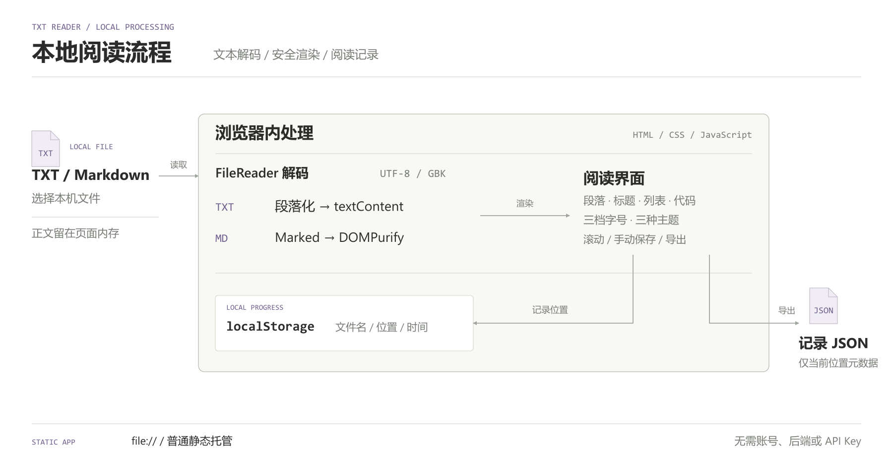

# TXT / Markdown 阅读器

[简体中文](README.md) | [English](README.en.md)

把本机的 TXT、Markdown 放进一个干净的阅读页面：切换 UTF-8 / GBK、调整字号和主题，下一次从保存的位置继续。

这是一个纯静态网页。**下载完整仓库，双击 `index.html` 即可使用**；无需账号、后端、Node.js 或 API Key。文档由浏览器读取，正文不会上传到应用服务器。

[打开并阅读](#打开一份文档) · [保存与导出](#保存进度与导出记录) · [工作原理](#工作原理) · [常见问题](#常见问题)

## 打开一份文档

1. 点击 GitHub 的 **Code → Download ZIP** 并解压，保留 `index.html` 和 `assets/` 的相对位置；也可克隆仓库：

```bash
git clone https://github.com/kayaduster607-jpg/txt-reader.git
cd txt-reader
```

2. 用浏览器打开根目录的 `index.html`，在文件选择框选择 [examples/sample.txt](examples/sample.txt)。想看标题、列表和代码排版，改选 [examples/sample.md](examples/sample.md)。
3. 文本出现后，切换“小 / 中 / 大”字号或“蓝 / 绿 / 黑”主题。如果中文不正常，切换 UTF-8 / GBK 重新解码。
4. 向下滚动，点击“保存进度”。关闭页面，再打开阅读器并选择**同名文档**，应恢复到保存位置附近。

选择自己的文件时，输入就是一个 `.txt` 或 `.md` 文件，无需填写路径、粘贴全文或转换成 JSON。当前加载后会隐藏文件选择区，换另一份文档时刷新页面再选。

## 保存进度与导出记录

| 操作 | 结果 | 在哪里找 |
| --- | --- | --- |
| 打开 TXT / Markdown | 段落或 Markdown 排版 | 当前阅读页面 |
| 停止滚动约 500 ms，或点击“保存进度” | 文件名、滚动像素位置、保存时间 | 当前浏览器的 localStorage |
| 点击“导出记录” | `<原文件名>_记录.json` | 浏览器下载目录 |

导出 JSON 使用 `bookName`、`position`、`date` 字段。它记录导出时读到哪里，不包含正文，也不会生成 PDF、EPUB 或 TXT 副本。当前没有把 JSON 导回阅读器的入口。

进度按文件名保存，因此两个不同目录里的同名文件会共用记录。位置采用像素而非章节，换字号、窗口宽度或正文后，恢复位置可能发生偏移。字号和主题本身不跨刷新保存。

需要长期稳定地访问同一份阅读器时，可从项目目录启动静态文件服务：

```bash
python -m http.server 8080 --bind 127.0.0.1
```

然后始终使用 [http://127.0.0.1:8080](http://127.0.0.1:8080)。这有助于固定浏览器存储所属的来源；浏览器对直接打开文件时的存储行为可能不同。清除网站数据或更换浏览器后，原进度不会自动迁移。

## 工作原理



`assets/reader.js` 用 FileReader 解码用户选择的文件。TXT 通过 `textContent` 显示，Markdown 先由 Marked 解析，再经 DOMPurify 清洗后写入页面。两项浏览器库均随仓库提供，普通阅读不依赖 CDN。

正文只存在于本次页面内存中；localStorage 的键为 `reader_progress_<文件名>`，只记录文件名、位置与时间。刷新页面后仍需重新选择原文。Markdown 自带的远程图片或外链可以产生网络请求，阅读器不会把这些资源自动离线化。

图示可下载为 [SVG](docs/assets/architecture.svg)，对应 [绘图源码](docs/assets/generate_architecture.py)。

## 常见问题

| 现象 | 处理方法 |
| --- | --- |
| 页面有按钮，但 Markdown 排版失效 | 确认下载了完整目录，`assets/vendor/` 没有缺失 |
| 重新打开后看不到正文 | 重新选择原文件；保存进度不会替你保存书籍正文 |
| 找不到上次进度 | 检查文件名、浏览器和访问地址是否一致，是否清理过网站数据 |
| 点击导出却没得到书籍 | 导出功能只生成阅读进度 JSON |
| 大文件打开很慢 | 当前一次载入全文，没有分页与流式读取 |

当前支持 TXT / Markdown，不提供 PDF、DOCX、EPUB、OCR、目录侧栏或云端书库。

## 修改与验证

运行阅读器无需安装下面的开发依赖。修改脚本或更新浏览器库时，在满足包引擎要求的 Node.js 环境运行：

```bash
npm ci --ignore-scripts
npm run vendor
npm test
npm run audit
```

测试范围与历史验证环境见 [验证记录](docs/validation.md)，第三方库版本与许可见 [THIRD_PARTY_NOTICES.md](THIRD_PARTY_NOTICES.md)。入口页面、业务脚本和测试分别位于 `index.html`、`assets/reader.js`、`tests/reader.test.mjs`。
